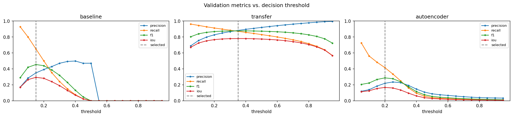
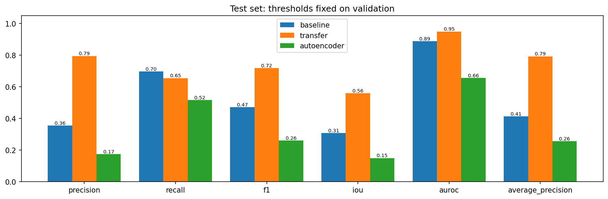
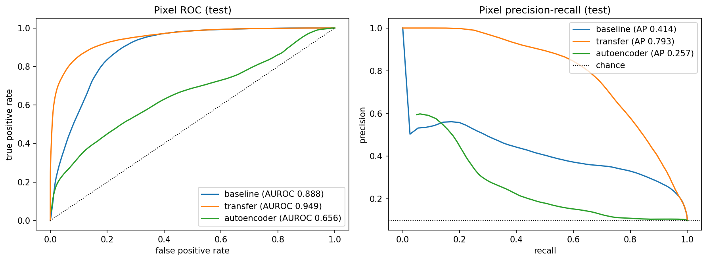
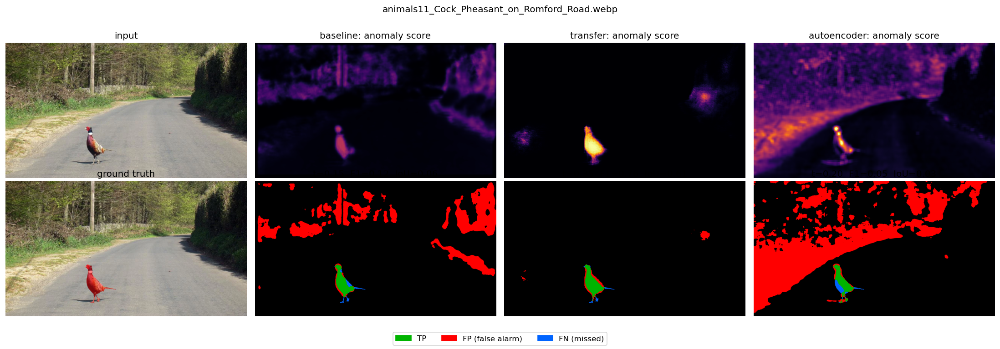
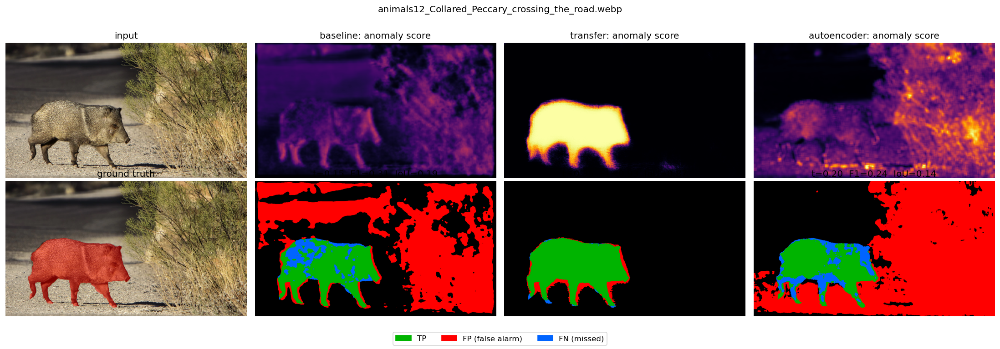
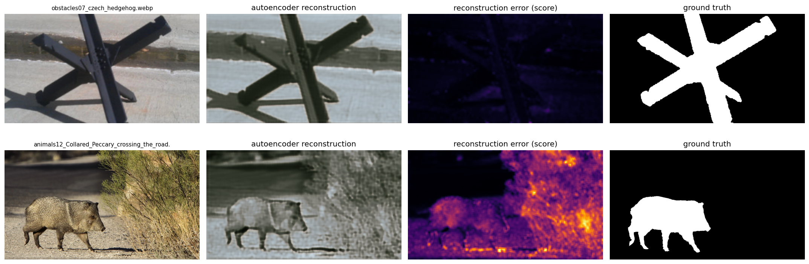
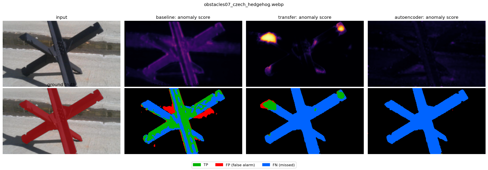
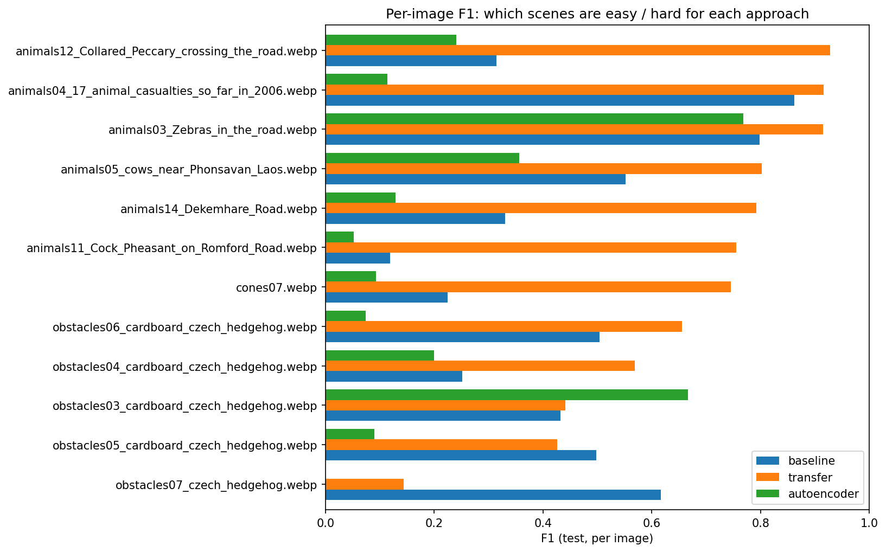

# Road Anomaly Segmentation on the RoadAnomaly Dataset

**Authors:** [Group member names]
**Module:** Deep Learning
**Experiment:** `20261104T172242_720026Z`

## 1. Problem statement

Autonomous vehicles must detect rare, unexpected obstacles (animals, rocks, cones, lost cargo)
that are absent from standard driving datasets. Given an RGB road image, we predict a per-pixel
anomaly score and a binary anomaly mask. The task is framed as **binary semantic segmentation**
(anomaly vs. background), complemented by a **reconstruction-based** approach inspired by
Lis et al. (ICCV 2019), who detect anomalies by resynthesising the image and comparing it with the input.

## 2. Dataset

* 60 RGB images (WebP), native size 1280x720, each with a semantic mask
  (`labels_semantic.png`, 0 = background, 2 = anomaly).
* Integrity checks: 60 valid pairs, 0 errors, every image contains an anomaly.
* Anomaly pixels: **9.85 %** of all pixels (strong class imbalance:
  a model predicting only background reaches 90.15 % accuracy,
  which is why accuracy is not reported as a main metric).
* Per-image anomaly area: median 6.62 %, min 0.37 %, max 42.33 %.

## 3. Methodology

### 3.1 Grouped split (leakage prevention)

Near-duplicate images (same scene or series) were grouped manually and each group was assigned to a
single partition (seed 42, 70 / 15 / 15 % of the groups).

| Partition | Images | Families |
| --- | --- | --- |
| train | 39 | animals: 22, cones: 6, obstacles: 9, vehicle: 2 |
| validation | 9 | animals: 3, cones: 1, lost_tires: 3, obstacles: 1, vehicle: 1 |
| test | 12 | animals: 6, cones: 1, obstacles: 5 |

Train fits the weights, validation selects checkpoints and decision thresholds, test is used **once** for the final evaluation.

### 3.2 Preprocessing

Images are resized to 640 x 360 (bilinear) and scaled to [0, 1]; masks are resized with nearest neighbour
and mapped 0/2 -> 0/1. Predictions are upsampled back to native resolution (bilinear) and evaluated
against the **original** masks.

### 3.3 Models

| Model | Description |
| --- | --- |
| baseline | Small encoder-decoder CNN trained from scratch (supervised segmentation). |
| transfer | U-Net with an ImageNet-pretrained MobileNetV2 encoder (transfer learning). |
| autoencoder | Convolutional autoencoder trained to reconstruct road background only; the per-pixel reconstruction error is the anomaly score (resynthesis idea, Lis et al. 2019). |

| Model | Trainable params | Frozen params | Loss | LR | Epochs | Best epoch | Train time (min) | Threshold |
| --- | --- | --- | --- | --- | --- | --- | --- | --- |
| baseline | 46689 | 0 | binary_crossentropy | 0.001 | n/a | n/a | n/a | 0.15 |
| transfer | 1492337 | 1841984 | binary_crossentropy | 0.001 | n/a | n/a | n/a | 0.35 |
| autoencoder | 583499 | 3 | masked_mse_background | 0.001 | 60 | 60 | 14.8 | 0.20 |

All models use Adam, early stopping on validation loss and keep the best checkpoint. Thresholds are chosen on
validation by maximising the pooled pixel F1 (grid 0.05-0.95).

## 4. Results

### 4.1 Pooled pixel metrics

| Model | Set | Precision | Recall | F1 | Dice | IoU | AUROC | AP | FPR@95TPR |
| --- | --- | --- | --- | --- | --- | --- | --- | --- | --- |
| baseline | validation | 0.3501 | 0.6507 | 0.4552 | 0.4552 | 0.2947 | 0.8723 | 0.3747 | 0.4618 |
| baseline | test | 0.3552 | 0.6961 | 0.4704 | 0.4704 | 0.3075 | 0.8877 | 0.4139 | 0.3324 |
| transfer | validation | 0.8825 | 0.8716 | 0.8770 | 0.8770 | 0.7809 | 0.9937 | 0.9545 | 0.0308 |
| transfer | test | 0.7947 | 0.6547 | 0.7179 | 0.7179 | 0.5600 | 0.9490 | 0.7926 | 0.2855 |
| autoencoder | validation | 0.2198 | 0.4161 | 0.2877 | 0.2877 | 0.1680 | 0.6811 | 0.1541 | 0.8275 |
| autoencoder | test | 0.1747 | 0.5168 | 0.2612 | 0.2612 | 0.1502 | 0.6562 | 0.2567 | 0.8841 |

F1 and Dice are identical for binary masks. Validation scores were used for selection and are optimistic.
Primary model selected on validation: **transfer**. Best model on test (F1): **transfer**.

### 4.2 Per-image F1 on test

| Model | Mean | Median | Min | Max |
| --- | --- | --- | --- | --- |
| baseline | 0.4585 | 0.4649 | 0.1187 | 0.8619 |
| transfer | 0.6741 | 0.7504 | 0.1436 | 0.9280 |
| autoencoder | 0.2319 | 0.1212 | 0.0005 | 0.7682 |

### 4.3 Test F1 / IoU per object family

| Model | Family | Images | F1 | IoU |
| --- | --- | --- | --- | --- |
| baseline | animals | 6 | 0.4917 | 0.3260 |
| baseline | cones | 1 | 0.2245 | 0.1265 |
| baseline | obstacles | 5 | 0.4544 | 0.2940 |
| transfer | animals | 6 | 0.8687 | 0.7679 |
| transfer | cones | 1 | 0.7457 | 0.5945 |
| transfer | obstacles | 5 | 0.3535 | 0.2147 |
| autoencoder | animals | 6 | 0.3106 | 0.1839 |
| autoencoder | cones | 1 | 0.0930 | 0.0487 |
| autoencoder | obstacles | 5 | 0.1776 | 0.0975 |

## 5. Visual results

**Figure 1.** `validation_threshold_curves`

**Figure 2.** `test_metrics_comparison`

**Figure 3.** `roc_pr_curves`

**Figure 4.** `animals11_Cock_Pheasant_on_Romford_Road_comparison`

**Figure 5.** `animals12_Collared_Peccary_crossing_the_road_comparison`

**Figure 6.** `autoencoder_reconstructions`

**Figure 7.** `obstacles07_czech_hedgehog_comparison`

**Figure 8.** `per_image_f1`

## 6. Critical analysis

[TO COMPLETE after reviewing the figures: compare precision/recall trade-offs, typical false alarms
(road markings, shadows, vehicles), missed anomalies (small or road-coloured objects), contour quality,
and the validation-test gap (small sets: 9 and 12 images, so one difficult scene changes the scores).]

## 7. Limitations and future work

* Only 60 images: high variance of scores and thresholds; the original authors designed RoadAnomaly as a
  *test-only* benchmark, so supervised training on part of it is a pedagogical protocol, not the original benchmark.
* Pixels of the same image are not independent; per-image metrics are reported to show the spread.
* Possible improvements: pre-training on a large driving dataset (Cityscapes) and anomaly data synthesis,
  stronger augmentation, encoder fine-tuning, Dice/focal losses, higher input resolution for small objects,
  and the full resynthesis pipeline of Lis et al. (semantic segmentation -> GAN resynthesis -> discrepancy network).

## 8. Conclusion

[TO COMPLETE: answer the objective in 4-5 sentences using the numbers above.]

## References

* K. Lis, K. Nakka, P. Fua, M. Salzmann. *Detecting the Unexpected via Image Resynthesis.* ICCV 2019.
* M. Sandler et al. *MobileNetV2: Inverted Residuals and Linear Bottlenecks.* CVPR 2018.
* O. Ronneberger et al. *U-Net: Convolutional Networks for Biomedical Image Segmentation.* MICCAI 2015.
* RoadAnomaly dataset documentation and `credits.txt` (image sources).

Numerical evidence: see `evidence/`.
