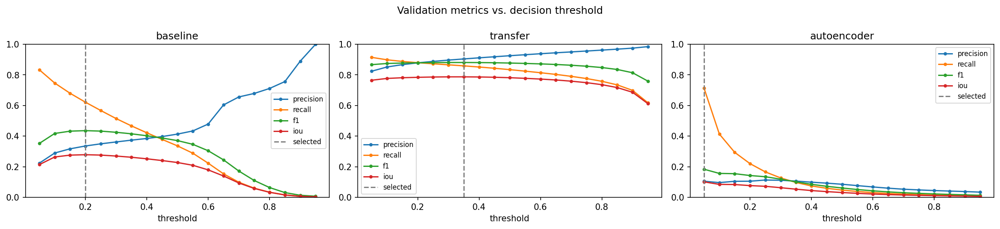
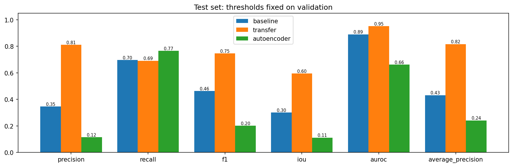
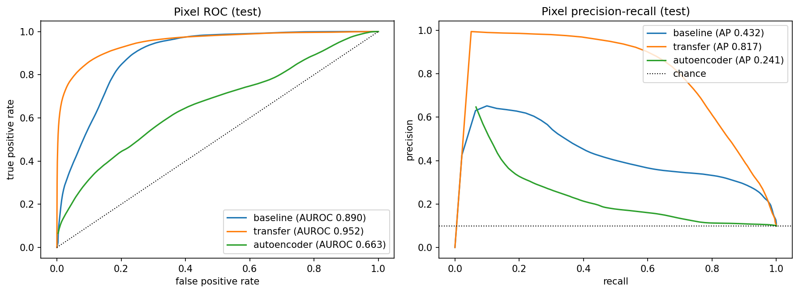
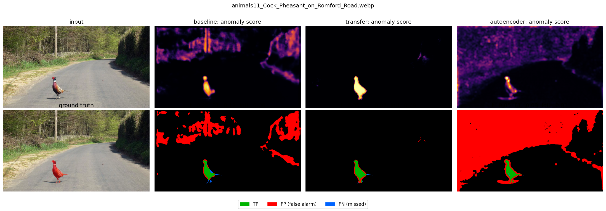
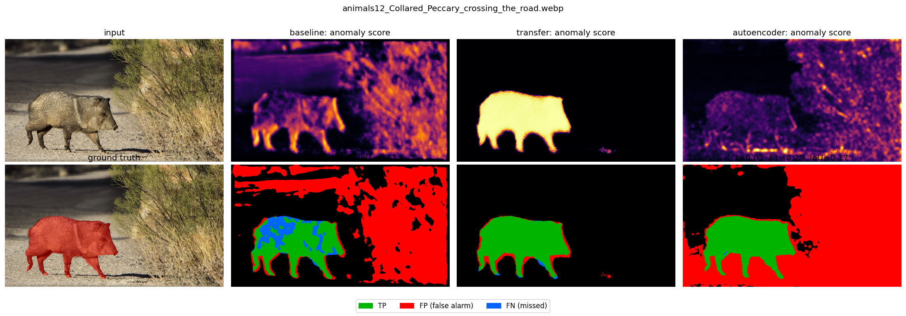
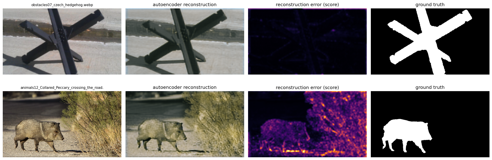
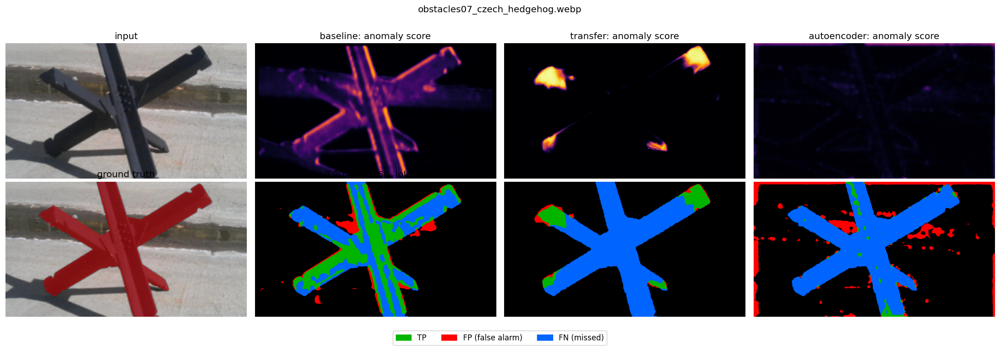
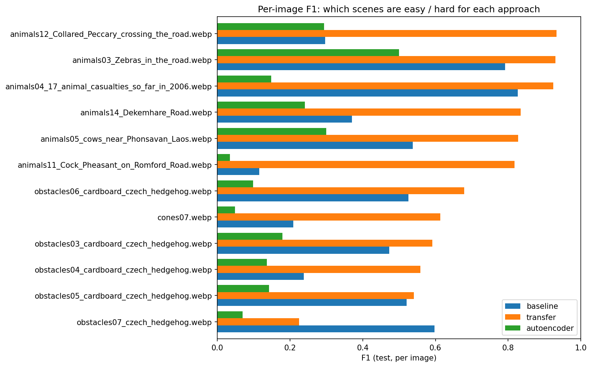

# Road Anomaly Segmentation on the RoadAnomaly Dataset

**Authors:** [Group member names]
**Module:** Deep Learning
**Experiment:** `20261107T094734_134561Z`

## 1. Problem statement

Autonomous vehicles must detect rare, unexpected obstacles (animals, rocks, cones, lost cargo)
that are absent from standard driving datasets. Given an RGB road image, we predict a per-pixel
anomaly score and a binary anomaly mask. The task is framed as **binary semantic segmentation**
(anomaly vs. background), complemented by a **reconstruction-based** approach inspired by
Lis et al. (ICCV 2019), who detect anomalies by resynthesising the image and comparing it with the input.

## 2. Dataset

* 60 RGB images (WebP), native size 1280x720, each with a semantic mask
  (`labels_semantic.png`, 0 = background, 2 = anomaly).
* Integrity checks: 60 valid pairs, 0 errors, every image contains an anomaly.
* Anomaly pixels: **9.85 %** of all pixels (strong class imbalance:
  a model predicting only background reaches 90.15 % accuracy,
  which is why accuracy is not reported as a main metric).
* Per-image anomaly area: median 6.62 %, min 0.37 %, max 42.33 %.

## 3. Methodology

### 3.1 Grouped split (leakage prevention)

Near-duplicate images (same scene or series) were grouped manually and each group was assigned to a
single partition (seed 42, 70 / 15 / 15 % of the groups).

| Partition | Images | Families |
| --- | --- | --- |
| train | 39 | animals: 22, cones: 6, obstacles: 9, vehicle: 2 |
| validation | 9 | animals: 3, cones: 1, lost_tires: 3, obstacles: 1, vehicle: 1 |
| test | 12 | animals: 6, cones: 1, obstacles: 5 |

Train fits the weights, validation selects checkpoints and decision thresholds, test is used **once** for the final evaluation.

### 3.2 Preprocessing

Images are resized to 640 x 360 (bilinear) and scaled to [0, 1]; masks are resized with nearest neighbour
and mapped 0/2 -> 0/1. Predictions are upsampled back to native resolution (bilinear) and evaluated
against the **original** masks.

### 3.3 Models

| Model | Description |
| --- | --- |
| baseline | Small encoder-decoder CNN trained from scratch (supervised segmentation). |
| transfer | U-Net with an ImageNet-pretrained MobileNetV2 encoder (transfer learning). |
| autoencoder | Convolutional autoencoder trained to reconstruct road background only; the per-pixel reconstruction error is the anomaly score (resynthesis idea, Lis et al. 2019). |

| Model | Trainable params | Frozen params | Loss | LR | Epochs | Best epoch | Train time (min) | Threshold |
| --- | --- | --- | --- | --- | --- | --- | --- | --- |
| baseline | 46689 | 0 | bce_dice | 0.001 | 34 | 24 | 2.2 | 0.20 |
| transfer | 2690801 | 643520 | bce_dice | 0.0003 | 15 | 29 | 2.5 | 0.35 |
| autoencoder | 583499 | 3 | masked_mse_background | 0.001 | 60 | 58 | 14.1 | 0.05 |

All models use Adam, early stopping on validation loss and keep the best checkpoint. Thresholds are chosen on
validation by maximising the pooled pixel F1 (grid 0.05-0.95).

## 4. Results

### 4.1 Pooled pixel metrics

| Model | Set | Precision | Recall | F1 | Dice | IoU | AUROC | AP | FPR@95TPR |
| --- | --- | --- | --- | --- | --- | --- | --- | --- | --- |
| baseline | validation | 0.3355 | 0.6217 | 0.4358 | 0.4358 | 0.2786 | 0.8554 | 0.3876 | 0.5344 |
| baseline | test | 0.3473 | 0.6968 | 0.4635 | 0.4635 | 0.3017 | 0.8904 | 0.4320 | 0.3156 |
| transfer | validation | 0.9041 | 0.8589 | 0.8809 | 0.8809 | 0.7872 | 0.9930 | 0.9485 | 0.0352 |
| transfer | test | 0.8113 | 0.6916 | 0.7467 | 0.7467 | 0.5958 | 0.9518 | 0.8166 | 0.2584 |
| autoencoder | validation | 0.1055 | 0.7142 | 0.1838 | 0.1838 | 0.1012 | 0.5864 | 0.1003 | 0.8061 |
| autoencoder | test | 0.1160 | 0.7665 | 0.2015 | 0.2015 | 0.1121 | 0.6627 | 0.2415 | 0.8778 |

F1 and Dice are identical for binary masks. Validation scores were used for selection and are optimistic.
Primary model selected on validation: **transfer**. Best model on test (F1): **transfer**.

### 4.2 Per-image F1 on test

| Model | Mean | Median | Min | Max |
| --- | --- | --- | --- | --- |
| baseline | 0.4582 | 0.4966 | 0.1151 | 0.8261 |
| transfer | 0.7062 | 0.7484 | 0.2247 | 0.9333 |
| autoencoder | 0.1824 | 0.1450 | 0.0341 | 0.5000 |

### 4.3 Test F1 / IoU per object family

| Model | Family | Images | F1 | IoU |
| --- | --- | --- | --- | --- |
| baseline | animals | 6 | 0.4843 | 0.3195 |
| baseline | cones | 1 | 0.2084 | 0.1163 |
| baseline | obstacles | 5 | 0.4513 | 0.2914 |
| transfer | animals | 6 | 0.8895 | 0.8010 |
| transfer | cones | 1 | 0.6129 | 0.4418 |
| transfer | obstacles | 5 | 0.4329 | 0.2762 |
| autoencoder | animals | 6 | 0.2744 | 0.1590 |
| autoencoder | cones | 1 | 0.0483 | 0.0248 |
| autoencoder | obstacles | 5 | 0.1321 | 0.0707 |

## 5. Visual results

**Figure 1.** `validation_threshold_curves`

**Figure 2.** `test_metrics_comparison`

**Figure 3.** `roc_pr_curves`

**Figure 4.** `animals11_Cock_Pheasant_on_Romford_Road_comparison`

**Figure 5.** `animals12_Collared_Peccary_crossing_the_road_comparison`

**Figure 6.** `autoencoder_reconstructions`

**Figure 7.** `obstacles07_czech_hedgehog_comparison`

**Figure 8.** `per_image_f1`

### 5.1 Chapter-3 studies on the baseline CNN (validation only)

Same seed, loss (BCE + Dice), augmentation and early stopping (patience 8, at most 40 epochs); ranked on the validation split by pooled F1 at its best threshold. The test set is not used. One seed and 9 validation images: two identical Adam runs differ by about 0.02 F1, so smaller differences are noise.

**Optimisers (SGD, momentum, RMSprop, Adam)**

| Variant | Optimiser | LR | Batch | Dropout | L2 | BN | Epochs | Val loss | Val F1 | Val IoU | Val AUROC |
| --- | --- | --- | --- | --- | --- | --- | --- | --- | --- | --- | --- |
| adam | adam | 1.0e-03 | 4 | 0.0 | 0.0 | False | 21 | 0.938 | 0.465 | 0.303 | 0.877 |
| rmsprop | rmsprop | 1.0e-03 | 4 | 0.0 | 0.0 | False | 22 | 0.968 | 0.446 | 0.287 | 0.865 |
| sgd_momentum | momentum | 1.0e-02 | 4 | 0.0 | 0.0 | False | 35 | 0.956 | 0.425 | 0.270 | 0.876 |
| sgd | sgd | 1.0e-02 | 4 | 0.0 | 0.0 | False | 40 | 1.081 | 0.391 | 0.243 | 0.838 |

**Regularisation (dropout, L2, batch-norm)**

| Variant | Optimiser | LR | Batch | Dropout | L2 | BN | Epochs | Val loss | Val F1 | Val IoU | Val AUROC |
| --- | --- | --- | --- | --- | --- | --- | --- | --- | --- | --- | --- |
| adam | adam | 1.0e-03 | 4 | 0.0 | 0.0 | False | 21 | 0.942 | 0.482 | 0.318 | 0.879 |
| l2_1e-4 | adam | 1.0e-03 | 4 | 0.0 | 0.0001 | False | 19 | 1.000 | 0.480 | 0.316 | 0.884 |
| batch_norm | adam | 1.0e-03 | 4 | 0.0 | 0.0 | True | 40 | 1.043 | 0.400 | 0.250 | 0.856 |
| dropout_0.4 | adam | 1.0e-03 | 4 | 0.4 | 0.0 | False | 9 | 1.268 | 0.177 | 0.097 | 0.556 |
| dropout_0.4+l2_1e-4 | adam | 1.0e-03 | 4 | 0.4 | 0.0001 | False | 9 | 1.301 | 0.177 | 0.097 | 0.553 |

**Random search (coarse_*) then finer search (fine_*)**

| Variant | Optimiser | LR | Batch | Dropout | L2 | BN | Epochs | Val loss | Val F1 | Val IoU | Val AUROC |
| --- | --- | --- | --- | --- | --- | --- | --- | --- | --- | --- | --- |
| coarse_5 | adam | 1.6e-03 | 8 | 0.0 | 0.0 | False | 36 | 0.924 | 0.506 | 0.338 | 0.900 |
| fine_1 | adam | 1.7e-03 | 8 | 0.0 | 0.0 | False | 32 | 0.906 | 0.505 | 0.338 | 0.890 |
| coarse_3 | adam | 1.1e-04 | 2 | 0.0 | 0.0 | False | 40 | 0.948 | 0.484 | 0.320 | 0.876 |
| fine_3 | adam | 1.0e-03 | 8 | 0.0 | 0.0 | False | 40 | 0.914 | 0.482 | 0.318 | 0.886 |
| coarse_2 | adam | 1.2e-04 | 2 | 0.0 | 0.0 | False | 40 | 0.946 | 0.467 | 0.305 | 0.871 |
| fine_2 | adam | 3.1e-03 | 8 | 0.0 | 0.0 | False | 15 | 0.968 | 0.448 | 0.289 | 0.868 |
| coarse_4 | adam | 6.7e-03 | 8 | 0.0 | 0.0 | False | 27 | 0.978 | 0.441 | 0.283 | 0.865 |
| coarse_1 | adam | 1.9e-03 | 4 | 0.0 | 0.0 | False | 22 | 0.957 | 0.439 | 0.281 | 0.865 |

**Reading the studies.**

* **Optimisers.** Adam (0.465) > RMSprop (0.446) > SGD + momentum (0.425) > plain SGD (0.391). The adaptive methods converge much faster at the same budget (Adam stopped after 21 epochs and 85 s; plain SGD used all 40 epochs, 254 s, and its best epoch was 38, i.e. it was still improving). This is the behaviour described in chapter 3: momentum damps the oscillations of SGD, RMSprop / Adam rescale the step per parameter. A longer or better-tuned SGD run could close part of the gap; it was not tested.
* **Regularisation.** Two identical Adam runs gave 0.465 and 0.482, so differences below about 0.02 F1 are noise. L2 (λ = 1e-4) gave 0.480: no measurable effect. In every run except batch-norm the validation loss is *lower* than the training loss (augmented images are harder than clean ones): the 46 k-parameter baseline **under-fits** rather than over-fits, so regularisation has little to correct. Batch-norm was worse (0.400; 40 epochs, validation loss above training loss): with batch size 4 the batch statistics are very noisy, and BN needs larger batches. Dropout 0.4 (the 40–50 % rule of thumb for CNNs) **failed to train** (F1 0.177, best epoch 1): a rate meant for large networks removes too much of a network with only 16–64 channels. A rate of 0.1–0.2 was not tested.
* **Hyper-parameter search.** The best random trial (learning rate 1.6e-3, batch size 8) reached 0.506; the three finer trials around it did not improve (best 0.505), so the search had already reached its plateau. Tuning improved the baseline by only 0.02-0.04 F1 over the default (0.465-0.482), and the tuned baseline stays far below the transfer model (validation F1 0.88). Lesson: **architecture and pre-training matter far more than hyper-parameter tuning here**. The tuned values were not used for the final baseline, to keep the three-model comparison on one fixed protocol.

## 6. Critical analysis

**Transfer learning is the only model that works well, and it works for the right reason.** The pre-trained MobileNetV2 U-Net reaches test F1 0.747 / IoU 0.596 / AUROC 0.952, against 0.464 / 0.302 / 0.890 for the from-scratch CNN and 0.202 / 0.112 / 0.663 for the autoencoder (chance level for AP is about 0.10; the transfer model reaches 0.82). On animals, its strongest family, F1 is 0.889: the ImageNet encoder already knows animals, and the skip connections give clean contours (Figure 5, peccary: almost no false alarms, thin one-pixel border errors only).

**The baseline fails because of its receptive field and lack of prior knowledge, not because of over-fitting.** Its receptive field is about 24 x 24 pixels, so it judges each pixel from a small patch, with no notion of "a whole animal". It lights up high-contrast texture (the bush in the peccary image is almost entirely a false alarm) and only partly fills large objects (blue holes inside the animal). It needs a low threshold (0.20) to reach recall 0.70, at the price of precision 0.35. The chapter-3 studies confirm that it under-fits: regularisation does not help, and tuning the learning rate and batch size gains at most 0.04 F1.

**The autoencoder is close to useless alone, and the reconstructions explain why.** Its reconstruction error follows image *texture*, not *anomaly*: the bush and the shadow edge have a large error, while the dark, smooth, textureless cardboard hedgehog is reconstructed almost perfectly (error close to 0, Figure 6), so it is missed. A small autoencoder generalises to any simple shape and fails on any detailed texture. Its best validation threshold sits at the lowest value of the grid (0.05), where it flags most pixels (recall 0.77, precision 0.12, about the 10 % base rate): a degenerate operating point, and a sign that the grid is too coarse for its scores (they are normalised by a high percentile and are mostly below 0.05). This is the limitation that Lis et al. address with semantic segmentation, a GAN and a learned discrepancy network. It is also weakly supervised here: the ground-truth masks are used to exclude anomalies from the loss.

**Where the best model still fails: objects unlike anything seen.** The five cardboard-hedgehog photos form one scene group and were all placed in the test set, so the model never saw a hedgehog. The obstacles family reaches F1 0.433 and the worst test image, `obstacles07_czech_hedgehog`, 0.225 (recall 0.13: only the four arm tips are detected, Figure 7). The network has learnt "things that look like animals or cones" more than "any obstacle", which is the open-set problem of the original benchmark. Cones (1 test image, F1 0.613) and the small pheasant (F1 0.817, small object) are the other weak spots, and the contours are slightly blurred by the 640 x 360 working resolution.

**Validation-to-test gap.** The transfer model falls from 0.881 (validation) to 0.747 (test), whereas the baseline and the autoencoder do not drop. This is not classical over-fitting of the weights: the validation set (9 images) contains no hedgehog and the test set (12 images) is 42 % hedgehog photos. With sets this small, one hard scene moves the pooled scores by 0.1 or more, and two identical training runs differ by about 0.02 F1. No confidence intervals are reported; treat differences below 0.05 as not significant, while the gaps between the three models (0.28 to 0.54 F1) are far larger than that noise.

## 7. Limitations and future work

* Only 60 images: high variance of scores and thresholds; the original authors designed RoadAnomaly as a
  *test-only* benchmark, so supervised training on part of it is a pedagogical protocol, not the original benchmark.
* Pixels of the same image are not independent; per-image metrics are reported to show the spread.
* Possible improvements: pre-training on a large driving dataset (Cityscapes) and anomaly data synthesis,
  stronger augmentation, encoder fine-tuning, Dice/focal losses, higher input resolution for small objects,
  and the full resynthesis pipeline of Lis et al. (semantic segmentation -> GAN resynthesis -> discrepancy network).

## 8. Conclusion

The objective was pixel-level detection of unexpected road obstacles from 60 annotated images. With a leakage-free grouped split and thresholds fixed on validation, a U-Net on an ImageNet-pre-trained MobileNetV2 encoder is clearly the best of the three approaches: test F1 0.747, IoU 0.596, AUROC 0.952, against F1 0.464 for a CNN trained from scratch and 0.202 for a reconstruction-based autoencoder. The chapter-3 studies show that the from-scratch CNN is limited by capacity and receptive field rather than by over-fitting, so neither regularisation nor hyper-parameter search closes the gap with transfer learning (validation F1 about 0.5 versus 0.88). The autoencoder follows texture rather than anomaly, which confirms why the literature adds semantic and adversarial components. The main weaknesses are the very small test set (12 images, 42 % from one unseen object type), the single seed, and the poor recall on unseen object categories such as the cardboard hedgehog; the next steps would be pre-training on a large driving dataset with synthetic anomalies, higher resolution, and group-aware cross-validation.

## References

* K. Lis, K. Nakka, P. Fua, M. Salzmann. *Detecting the Unexpected via Image Resynthesis.* ICCV 2019.
* M. Sandler et al. *MobileNetV2: Inverted Residuals and Linear Bottlenecks.* CVPR 2018.
* O. Ronneberger et al. *U-Net: Convolutional Networks for Biomedical Image Segmentation.* MICCAI 2015.
* RoadAnomaly dataset documentation and `credits.txt` (image sources).

Numerical evidence: see `evidence/`.
