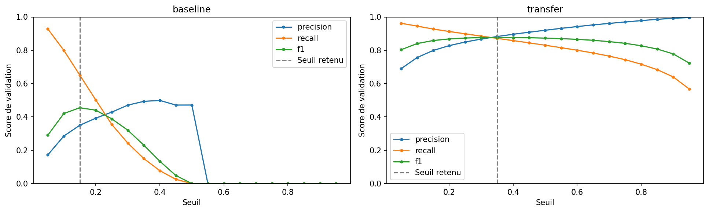
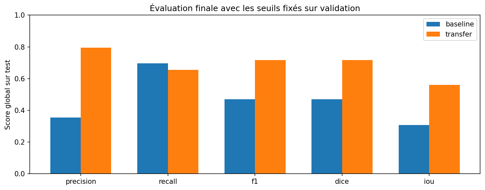
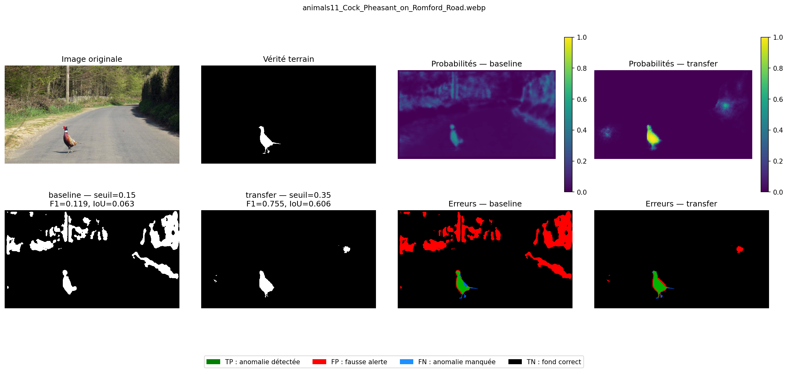
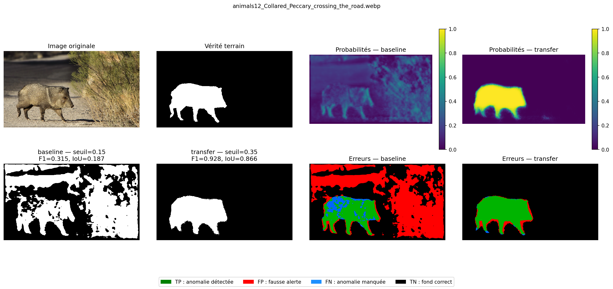
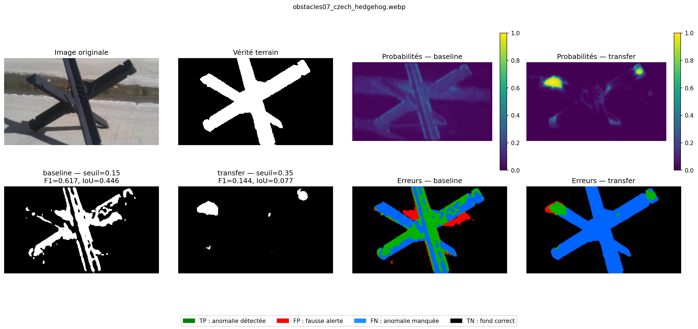

# Segmentation des anomalies routières avec RoadAnomaly

**Groupe :** [À COMPLÉTER : noms et identifiants]  
**Module :** Deep Learning  
**Expérience :** 20261030T170429_728027Z

## 1. Problématique et objectif

Le projet étudie la localisation d’anomalies dans des scènes routières.
À partir d’une image RGB, les modèles produisent un score d’anomalie
pour chaque pixel, puis un masque binaire.

Il s’agit d’une segmentation sémantique binaire supervisée.
Le projet ne cherche pas à distinguer les espèces animales ou les
catégories individuelles d’obstacles.

## 2. Dataset

Les partitions enregistrées couvrent 60 observations.
Chaque observation associe une image WebP à un masque sémantique PNG.
Les labels originaux sont 0 pour le fond et 2 pour l’anomalie.

Les fichiers d’instances et les visualisations colorées ne sont pas utilisés
comme cibles d’apprentissage.

[À COMPLÉTER : dimensions originales, résultats des contrôles d’intégrité,
proportion d’anomalie et exemples issus de l’exploration.]

La documentation présente RoadAnomaly comme un jeu destiné au test
d’algorithmes de perception. L’utilisation d’une partie des images pour
apprendre constitue ici une expérience pédagogique supervisée avec
un protocole propre. Les scores ne reproduisent pas directement le
benchmark original de détection d’objets inconnus.

## 3. Partitionnement et prévention des fuites

Les images potentiellement apparentées sont regroupées dans une même
partition. La séparation est réalisée avant les transformations
d’apprentissage.

[À COMPLÉTER : groupes retenus et justification visuelle de chaque groupe.]

| Partition | Nombre d’images |
| --- | --- |
| train | 39 |
| validation | 9 |
| test | 12 |

L’entraînement apprend les poids. La validation sert à sélectionner les
checkpoints et les seuils. Le test est réservé à l’évaluation finale.

## 4. Prétraitement

Les images sont préparées à 640 × 360 pixels,
avec interpolation bilinéaire, conversion en float32 et division par 255.
Les masques d’apprentissage utilisent le plus proche voisin, puis leurs
labels sont convertis de 0/2 vers 0/1.

Le modèle avec transfert contient sa transformation spécifique vers
[-1, 1]. Un padding interne assure la compatibilité avec l’encodeur ;
la bordure correspondante est retirée de la sortie.

[À COMPLÉTER : observations sur la conservation des petits objets.]

## 5. Modèles

### 5.1. CNN de référence

Le modèle de référence est un petit CNN encodeur–décodeur initialisé
sans poids préentraînés. Il combine convolutions, ReLU, max-pooling,
upsampling et sortie sigmoid à un canal.

[À COMPLÉTER : nombre de paramètres et résumé de l’architecture.]

### 5.2. Modèle avec transfert

Le second modèle est de type U-Net et utilise MobileNetV2 préentraîné
sur ImageNet comme encodeur. Des connexions entre encodeur et décodeur
transmettent des caractéristiques à plusieurs résolutions.

Le gel de l’encodeur enregistré pour cette expérience est :
True.

[À COMPLÉTER : nombres de paramètres entraînables et non entraînables.]

Les architectures diffèrent en plus du préentraînement. La comparaison
porte donc sur les approches complètes et ne permet pas d’isoler
l’effet du seul transfert d’apprentissage.

## 6. Entraînement et sélection

Les modèles sont entraînés avec Adam et la Binary Cross-Entropy.
L’arrêt anticipé et le checkpoint sont guidés par la perte de validation.

| Modèle | Learning rate | Batch size | Maximum d’époques | Patience | Seuil retenu |
| --- | --- | --- | --- | --- | --- |
| baseline | 0.001 | 4 | 50 | 7 | 0.1500 |
| transfer | 0.001 | 4 | 50 | 7 | 0.3500 |

[À COMPLÉTER : époques réellement effectuées, meilleure époque,
durée et matériel pour chaque expérience.]

Une grille de seuils est examinée sur validation. Le critère principal
est le F1 obtenu à partir des comptes de pixels cumulés. Les égalités
sont départagées par le rappel, puis la proximité avec 0,5.

Le modèle principal choisi sur validation est : **transfer**.

## 7. Protocole d’évaluation

Les probabilités sont agrandies par interpolation bilinéaire à la
résolution originale avant seuillage. Les annotations originales
restent inchangées.

La décision est « anomalie si probabilité > seuil ».
Les divisions par zéro retournent 0.

Les métriques sont precision, recall, F1, Dice et IoU.
F1 et Dice sont numériquement identiques pour les mêmes comptes binaires.

## 8. Résultats quantitatifs

### 8.1. Comptes de pixels cumulés

| Modèle | Ensemble | Precision | Recall | F1 | Dice | IoU |
| --- | --- | --- | --- | --- | --- | --- |
| baseline | validation | 0.3501 | 0.6507 | 0.4552 | 0.4552 | 0.2947 |
| baseline | test | 0.3552 | 0.6961 | 0.4704 | 0.4704 | 0.3075 |
| transfer | validation | 0.8825 | 0.8716 | 0.8770 | 0.8770 | 0.7809 |
| transfer | test | 0.7947 | 0.6547 | 0.7179 | 0.7179 | 0.5600 |

Les résultats de validation ont servi à la sélection et ne constituent
pas une estimation indépendante de performance.

### 8.2. Distribution des F1 par image sur test

| Modèle | F1 moyen | F1 médian | F1 minimum | F1 maximum |
| --- | --- | --- | --- | --- |
| baseline | 0.4585 | 0.4649 | 0.1187 | 0.8619 |
| transfer | 0.6741 | 0.7504 | 0.1436 | 0.9280 |

Ces statistiques par image sont distinctes du F1 calculé à partir
des comptes de pixels cumulés.

## 9. Résultats visuels

### Figure 1

[À COMPLÉTER : légende, observation et interprétation.]

### Figure 2

[À COMPLÉTER : légende, observation et interprétation.]

### Figure 3

[À COMPLÉTER : légende, observation et interprétation.]

### Figure 4

[À COMPLÉTER : légende, observation et interprétation.]

### Figure 5

[À COMPLÉTER : légende, observation et interprétation.]

## 10. Analyse critique

[À COMPLÉTER : différences de precision, recall et IoU entre approches.]

[À COMPLÉTER : fausses alertes, anomalies manquées et erreurs de contours,
avec références aux figures.]

[À COMPLÉTER : scènes où chaque approche réussit ou échoue.]

[À COMPLÉTER : écart entre validation et test, sans attribuer
automatiquement tout écart au surapprentissage.]

## 11. Limites et améliorations possibles

La petite taille du dataset limite la stabilité des scores et des seuils.
Les pixels d’une même image ne constituent pas des scènes indépendantes.

[À COMPLÉTER : autres limites effectivement observées.]

[À COMPLÉTER : améliorations reliées aux erreurs, à examiner dans une
nouvelle expérience de développement sans régler les modèles sur le test.]

## 12. Conclusion

[À COMPLÉTER : réponse à l’objectif, principaux résultats,
apport et limites de chaque approche.]

Le modèle principal reste celui sélectionné sur validation.
Aucun seuil ni poids n’est modifié à partir des résultats du test.

## 13. Références et traçabilité

- Documentation originale RoadAnomaly et crédits des images.
- Lis et al., Detecting the Unexpected via Image Resynthesis, ICCV 2019.
- Fiche disponible : Revision_Deep_Learning_Cours_Pratique.pdf.
- Documentation officielle TensorFlow/Keras utilisée pour l’implémentation.

Les convolutions, activations, pertes et principes d’entraînement sont
reliés à la fiche. Le décodeur, les connexions de type U-Net et le transfert
d’apprentissage sont des adaptations complémentaires expliquées
dans le notebook.

[À COMPLÉTER : liens exacts des références utilisées.]

Les configurations et résultats numériques sont fournis dans evidence/.
